# Modelo de datos

Esquema de la base de datos de **Cocina sin estrés** (MySQL 8, InnoDB, utf8mb4). Lo crea la migración [`V1__esquema_inicial.sql`](../backend/src/main/resources/db/migration/V1__esquema_inicial.sql) (KAN-12) y lo amplían las migraciones V2 a V19. Responde a las decisiones ADR-13 a ADR-25.

Actualizado al 4 de noviembre de 2026, hasta `V19__vencimiento_estimado.sql` (auditoría externa: «documentan unas 17 tablas, pero cuenta con 23»). **23 tablas en 7 grupos**, más `flyway_schema_history`, que es de Flyway:

| Grupo | Tablas | Proceso |
| --- | --- | --- |
| Identidad | `usuario` | 1. Usuario y autenticación |
| Perfil del hogar | `hogar`, `persona` | 1. Usuario y autenticación |
| Catálogo | `restriccion`, `producto`, `producto_restriccion`, `receta`, `ingrediente_receta`, `reemplazo_producto` (V8), `auditoria_catalogo` | 2 y 3, curaduría |
| Despensa | `item_despensa`, `equivalencia_hogar` | 2. Despensa virtual |
| Planificador | `plan_semanal`, `comida_plan`, `lista_compras`, `item_lista_compras`, `tienda` (V13) | 3. Planificador y recetario |
| Avisos | `aviso`, `hogar_preferencia_aviso` | 4. Notificaciones |
| Medición (indicadores del Plan de Calidad) | `apertura_app` (V14), `uso_rescate` (V15), `preparacion` (V15), `inicio_sesion` (V16) | Panel de Análisis del administrador |

Cuándo apareció cada cosa: V2 a V5 cargan el catálogo y las recetas; V6 alergias por persona; V7 plato fuerte y niños; V8 adaptar recetas a alergias; V9 despensa automática y vida útil; V10 video de la receta; V11 borrador de la semana y avisos con acción; V12 un tiempo por paso; V13 tiendas; V14 a V16 medición; V17 momentos del día y categorías cerradas; V18 recetario colombiano; V19 vencimiento estimado.

## Diagrama entidad-relación

```mermaid
erDiagram
    usuario ||--o| hogar : "tiene"
    hogar ||--|{ persona : "integran"
    hogar ||--o{ item_despensa : "guarda"
    hogar ||--o{ producto : "registra adicionales"
    hogar ||--o{ equivalencia_hogar : "define"
    hogar ||--o{ plan_semanal : "planea"
    hogar ||--o{ aviso : "recibe"
    hogar ||--o{ hogar_preferencia_aviso : "configura"
    producto ||--o{ item_despensa : "se guarda como"
    producto ||--o{ producto_restriccion : "incumple"
    restriccion ||--o{ producto_restriccion : "aplica a"
    receta ||--|{ ingrediente_receta : "lleva"
    producto ||--o{ ingrediente_receta : "se usa en"
    producto ||--o{ equivalencia_hogar : "se reemplaza por"
    producto ||--o{ reemplazo_producto : "se cambia por (alergias)"
    plan_semanal ||--o{ comida_plan : "contiene"
    receta ||--o{ comida_plan : "se asigna a"
    plan_semanal ||--o| lista_compras : "genera"
    lista_compras ||--o{ item_lista_compras : "contiene"
    producto ||--o{ item_lista_compras : "se compra como"
    usuario ||--o{ producto : "modifica (curador)"
    usuario ||--o{ receta : "modifica (curador)"
    usuario ||--o{ auditoria_catalogo : "registra"
    usuario ||--o{ inicio_sesion : "mide (V16)"
    hogar ||--o{ tienda : "pide a (V13)"
    hogar ||--o{ preparacion : "cocina (V15)"
    receta ||--o{ preparacion : "se cocina en"
    comida_plan |o--o{ preparacion : "del plan, si lo es"
    hogar ||--o{ apertura_app : "abre (V14)"
    hogar ||--o{ uso_rescate : "usa el rescate (V15)"

    usuario {
        bigint id PK
        varchar firebase_uid UK
        varchar correo
        varchar rol "USUARIA, CURADOR, ADMIN"
        boolean perfil_completo
        boolean activo
    }
    hogar {
        bigint id PK
        bigint usuario_id FK,UK
        decimal presupuesto_monto
        varchar periodicidad_ingreso "SEMANAL, QUINCENAL, MENSUAL"
        tinyint dia_pago_1
        tinyint dia_pago_2
        json dias_sin_tiempo
        text restricciones "cifrado AES-GCM"
        text otras_condiciones "cifrado AES-GCM"
        boolean sin_restricciones
        datetime consentimiento_datos_en
    }
    persona {
        bigint id PK
        bigint hogar_id FK
        varchar nombre
        tinyint edad
        text restricciones "cifrado AES-GCM (V6)"
        text alergias_graves "cifrado AES-GCM (V8)"
    }
    restriccion {
        bigint id PK
        varchar codigo UK
        varchar nombre
        varchar tipo "ALERGIA, CONDICION"
    }
    producto {
        bigint id PK
        bigint hogar_id FK "NULL = catalogo global"
        varchar nombre
        varchar categoria "lista cerrada (V17)"
        varchar tipo_cantidad "CONTABLE, GRANEL"
        varchar unidad_base "g, ml, unidad"
        smallint vida_util_dias "V9"
        varchar unidad_compra
        decimal cantidad_unidad_compra
        decimal precio_unidad_compra
        decimal capacidad_referencia "solo granel"
        boolean es_basico
        boolean activo
        bigint modificado_por FK
    }
    producto_restriccion {
        bigint producto_id PK,FK
        bigint restriccion_id PK,FK
    }
    item_despensa {
        bigint id PK
        bigint hogar_id FK
        bigint producto_id FK
        decimal cantidad
        boolean es_estimada
        decimal cantidad_minima
        date vence_en
        boolean vence_estimado "V19"
        varchar ubicacion
    }
    receta {
        bigint id PK
        varchar nombre
        varchar descripcion
        smallint tiempo_minutos
        tinyint porciones
        text pasos
        text preparacion_previa
        boolean activa
        boolean es_plato_fuerte "V7"
        boolean gusta_a_ninos "V7"
        varchar video_youtube_id "V10"
        int video_inicio_seg "V10"
        int video_fin_seg "V10, máx. la mitad del tiempo"
        boolean para_desayuno "V17"
        boolean para_almuerzo "V17"
        boolean para_cena "V17"
        bigint modificado_por FK
    }
    ingrediente_receta {
        bigint id PK
        bigint receta_id FK
        bigint producto_id FK
        decimal cantidad
        boolean opcional
        boolean es_principal "V8"
    }
    reemplazo_producto {
        bigint id PK
        bigint producto_id FK
        bigint reemplazo_id FK
        varchar origen "SISTEMA | CURADOR (V8)"
        boolean activo
    }
    equivalencia_hogar {
        bigint id PK
        bigint hogar_id FK
        bigint producto_receta_id FK
        bigint producto_hogar_id FK
    }
    plan_semanal {
        bigint id PK
        bigint hogar_id FK
        date semana_inicio
        boolean borrador "V11"
        datetime completado_en
        int segundos_planificacion "V16"
    }
    comida_plan {
        bigint id PK
        bigint plan_semanal_id FK
        tinyint dia "1 a 7"
        varchar tipo_comida "DESAYUNO, ALMUERZO, CENA"
        bigint receta_id FK
        boolean preparada
        datetime preparada_en
        varchar id_cambio_cliente UK
    }
    lista_compras {
        bigint id PK
        bigint plan_semanal_id FK,UK
        datetime generada_en
    }
    item_lista_compras {
        bigint id PK
        bigint lista_compras_id FK
        bigint producto_id FK
        decimal cantidad
        decimal costo_estimado
        decimal costo_real "lo que pagó (KAN-26)"
        smallint prioridad
        boolean comprado
        varchar motivo "PLAN, REPONER, ALERGIA (V9)"
        decimal cantidad_agregada "V9"
    }
    aviso {
        bigint id PK
        bigint hogar_id FK
        varchar tipo
        varchar titulo "V11"
        varchar mensaje
        varchar enlace "V11"
        varchar accion "V11"
        varchar clave_idempotencia UK
        boolean leido
    }
    hogar_preferencia_aviso {
        bigint hogar_id PK,FK
        varchar tipo PK
        boolean activo
    }
    auditoria_catalogo {
        bigint id PK
        varchar entidad
        bigint entidad_id
        varchar accion "CREAR, EDITAR, DESACTIVAR"
        bigint usuario_id FK
        datetime fecha
        json cambios
    }
    tienda {
        bigint id PK
        bigint hogar_id FK
        varchar nombre
        varchar whatsapp
    }
    preparacion {
        bigint id PK
        bigint hogar_id FK
        bigint receta_id FK
        bigint comida_plan_id FK "NULL si fue fuera del plan"
        datetime creada_en
    }
    apertura_app {
        bigint id PK
        bigint hogar_id FK
        smallint avisos_vigentes
        smallint avisos_mostrados
        tinyint reglas_evaluadas
        int duracion_ms
    }
    uso_rescate {
        bigint id PK
        bigint hogar_id FK
        smallint opciones
    }
    inicio_sesion {
        bigint id PK
        bigint usuario_id FK
        int duracion_ms
        smallint fallidos_previos
    }
```



## Reglas que aplica la base de datos

Además de llaves y tipos, el esquema rechaza estos datos inválidos con restricciones `CHECK` y `UNIQUE`:

| Regla | Dónde | ADR / RNF |
| --- | --- | --- |
| Un usuario tiene como máximo un hogar | `uk_hogar_usuario_id` | ADR-13 |
| El presupuesto es mayor que cero, y los días de pago corresponden a la periodicidad (semanal 1-7; mensual 1-31; quincenal dos días en orden) | `ck_hogar_presupuesto`, `ck_hogar_dias_pago` | ADR-14 |
| No se puede marcar "sin restricciones" y a la vez guardar restricciones | `ck_hogar_restricciones` | ADR-13, RNF-01 |
| Un producto a granel tiene capacidad de referencia; uno contable no | `ck_producto_capacidad` | ADR-15 |
| Todo producto del catálogo tiene precio de referencia completo y un curador responsable | `ck_producto_catalogo` | RNF-02, RNF-24 |
| Un producto aparece una sola vez en la despensa de un hogar | `uk_item_despensa_hogar_id_producto_id` | ADR-15 |
| Cantidades nunca negativas; ingredientes con cantidad mayor que cero | `ck_item_despensa_cantidades`, `ck_ingrediente_receta_cantidad` | RNF-02 |
| Una sola receta por día y comida en el plan | `uk_comida_plan_plan_semanal_id_dia_tipo_comida` | — |
| Un cambio reenviado por el navegador no se aplica dos veces | `uk_comida_plan_id_cambio_cliente` | ADR-21, RNF-17 |
| Un aviso repetido no se inserta | `uk_aviso_clave_idempotencia` | ADR-17 |
| Un producto no es reemplazo de sí mismo ni aparece dos veces como reemplazo del mismo; lo que decide un curador queda a su nombre | `ck_reemplazo_producto_distintos`, `uk_reemplazo_producto_producto_id_reemplazo_id`, `ck_reemplazo_producto_curador` | ADR-24 |
| La categoría de un producto es de la lista de la app (granos, legumbres, tubérculos, harinas, proteínas, lácteos, verduras, frutas, aceites, condimentos, bebidas u otros) | `ck_producto_categoria` (V17) | RNF-24 |
| Todo cambio del catálogo tiene un curador identificable | `auditoria_catalogo.usuario_id NOT NULL` | ADR-23, RNF-24 |
| Un curador con historia en el catálogo no se puede borrar, y un producto usado en una receta tampoco | Llaves foráneas sin cascada | ADR-23 |

## Por qué hay dos registros de preparación

La auditoría externa señaló una posible redundancia entre `comida_plan.preparada` y la tabla `preparacion`. No guardan lo mismo:

- `comida_plan.preparada` y `preparada_en` dicen si **esa comida del plan** ya se cocinó. Es lo que pinta el plan del día y lo que evita descontar dos veces la despensa.
- `preparacion` registra **cada vez que se cocina una receta**, esté o no en el plan (el Modo cocinar también se usa desde el recetario). De ahí sale el indicador «recetas más cocinadas» del panel de Análisis (KAN-54). Cuando la preparación viene del plan, `comida_plan_id` apunta a la comida, así que el dato no se contradice.

Unirlas obligaría a crear una comida de plan falsa para lo que se cocina fuera del plan, o a perder ese uso en el indicador.

## Qué pasa al borrar

- **Al eliminar una cuenta** (`usuario`), se borran en cascada su hogar y todo lo que depende de él: personas, despensa, productos adicionales, equivalencias, planes, comidas, listas de compras, tiendas, avisos, preferencias y los registros de medición.
- **El catálogo nunca se borra.** Productos, recetas y restricciones se desactivan (`activo = FALSE`), porque despensas, planes y la auditoría siguen apuntando a ellos.

## Lo que valida la aplicación, no la base de datos

- `hogar.restricciones`, `hogar.otras_condiciones`, `persona.restricciones` y `persona.alergias_graves` llegan cifradas (ADR-20). Por eso la base no puede validar los códigos, y lo hace el servicio de perfil antes de cifrar. Además de los de `restriccion`, una persona puede tener `producto:<id>`: alergia a un ingrediente que no está en la lista (auditoría del 4 de noviembre, ADR-24).
- Los ingredientes de una receta deben ser productos del catálogo global (`producto.hogar_id IS NULL`).
- Los campos obligatorios del perfil (RNF-01) se exigen al terminar el onboarding, cuando se marca `usuario.perfil_completo`.
- El nivel visible de un producto a granel (Lleno, Medio, Poco, Agotado) se calcula a partir de `cantidad / capacidad_referencia` en `domain/` (ADR-15). No se guarda.

## Para el backend (KAN-8)

- Las columnas de valores cerrados son `VARCHAR` con `CHECK`, no `ENUM` de MySQL. En JPA se mapean con `@Enumerated(EnumType.STRING)` y, si se usa `ddl-auto=validate`, también con `@JdbcTypeCode(SqlTypes.VARCHAR)`.
- Dinero en `BigDecimal` con escala 2; cantidades en `BigDecimal` con escala 3.
- Fechas y horas en UTC (`DATETIME(3)`). La conversión a America/Bogota se hace al mostrarlas.

## Cómo probarlo en tu computador

```bash
docker compose up -d mysql          # MySQL 8.4 en localhost:3306
bash scripts/probar-esquema.sh      # aplica V1 en una base temporal y corre 55 pruebas
```

El script crea la base `cocina_prueba`, aplica la migración, verifica la estructura, inserta datos válidos, intenta 27 operaciones inválidas que deben ser rechazadas, prueba el borrado en cascada de una cuenta y al final borra la base temporal. No toca `cocina_sin_estres`, que es la base de desarrollo; esa la llenará Flyway cuando exista el backend.
